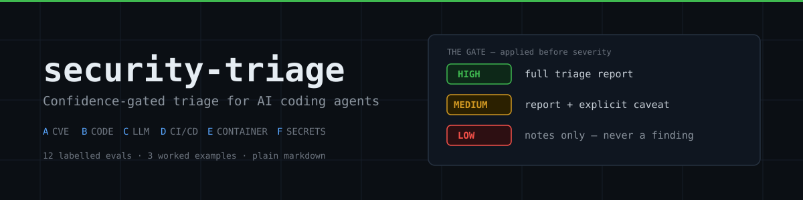
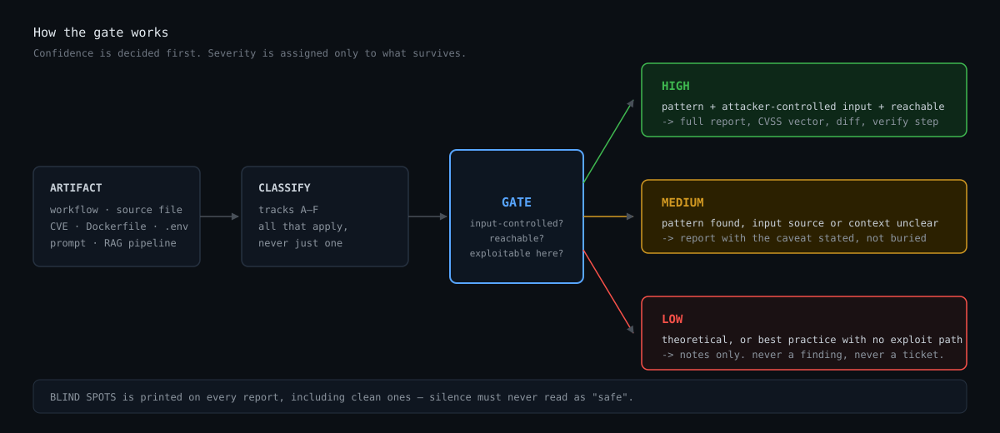

<p align="center">
  
</p>

# security-triage

**A confidence-gated security triage skill for AI coding agents.** Six tracks. A gate that
suppresses false positives before severity is assigned. Output a developer can act on.

Works with Claude Code, Cursor, Codex, Copilot, Gemini CLI, Windsurf, Aider, Cline, Zed,
Continue — anything that reads a markdown prompt. It is a `SKILL.md` where the runtime has
that convention, and a plain instruction file everywhere else.

[](https://github.com/S3DFX-CYBER/Claude-Skills-Security/releases/latest)
[](LICENSE)
[](https://code.claude.com/docs/en/skills)
[](https://genai.owasp.org/resource/owasp-genai-llm-top-10-2026/)
[](evals/)

---

## The problem

A scanner gives you 47 findings. Four are real. You do not know which four, so you either
read all 47 or you ignore all 47. Both are the wrong answer, and both are expensive.

This skill answers the question scanners cannot:

- **Is this exploitable** in this deployment, or is it a pattern with nothing behind it?
- **Does the CVSS base score reflect real risk here** — or is a 9.8 on an internal-only
  service less urgent than a 5.4 on a public API with open registration?
- **Is this model-level or application-level** — i.e. can it be fixed in code at all?
- **What can an attacker actually do**, and what is the smallest change that stops it?

The difference between a scanner and a triager is judgment. This encodes the judgment.

---

## The gate

Every finding passes a confidence gate **before** severity is assigned.

| Confidence | Condition | Output |
|---|---|---|
| **HIGH** | Vulnerable pattern confirmed **and** attacker-controlled input confirmed **and** exploitable in this context | Full triage report |
| **MEDIUM** | Pattern found, but input source unclear or exploitability context-dependent | Report with explicit caveat |
| **LOW** | Theoretical, or best-practice deviation with no exploit path | **Not a finding.** Notes section only |

This is the whole product. A dangerous sink fed by a constant is not a vulnerability, and
reporting it as one is how security tooling loses its audience.

See it work: **[examples/02-false-positive](examples/02-false-positive/)** — six scanner
flags, zero findings, and the reason for each.

<p align="center">
  
</p>

---

## Quick start

### Claude Code

```bash
git clone https://github.com/S3DFX-CYBER/Claude-Skills-Security.git
mkdir -p .claude/skills
cp -r Claude-Skills-Security/skills/security-triage .claude/skills/
```

That gives you `.claude/skills/security-triage/SKILL.md` — the layout Claude Code
discovers. Then `/security-triage`, or just paste a workflow file and ask.

For every project on the machine, use `~/.claude/skills/` instead.

### Claude.ai

Upload `skills/security-triage/SKILL.md` as a skill, or paste it into a Project's
instructions.

### Any other runtime

The skill is plain markdown with YAML frontmatter. Feed it as a system prompt or
instructions block:

```python
from pathlib import Path
skill = Path("skills/security-triage/SKILL.md").read_text()

# OpenAI / Codex
client.responses.create(model="codex-mini-latest", instructions=skill, input=artifact)

# Any OpenAI-compatible API
client.chat.completions.create(
    model="...",
    messages=[{"role": "system", "content": skill},
              {"role": "user", "content": artifact}],
)
```

```bash
# Gemini CLI
gemini -s "$(cat skills/security-triage/SKILL.md)" "Triage this Dockerfile: $(cat Dockerfile)"
```

| Runtime | Method | Status |
|---|---|---|
| Claude Code | `.claude/skills/security-triage/SKILL.md` | Primary |
| claude.ai | Skill upload or Project instructions | Tested |
| OpenAI Codex / Responses API | `instructions` | Tested |
| Any OpenAI-compatible API | `system` message | Compatible |
| Cursor / Windsurf | rules file referencing the SKILL.md | Tested |
| GitHub Copilot | `.github/copilot-instructions.md` | Tested |
| Gemini CLI | `-s` system prompt | Tested |

Details and per-runtime quirks: [COMPATIBILITY.md](COMPATIBILITY.md).
Agent discovery and invocation contracts: [AGENTS.md](AGENTS.md).

### One command, any agent

```bash
git clone https://github.com/S3DFX-CYBER/Claude-Skills-Security.git
cd Claude-Skills-Security

./install.sh claude        # .claude/skills/security-triage/SKILL.md
./install.sh cursor        # .cursor/rules/security-triage.mdc
./install.sh codex         # appends to AGENTS.md
./install.sh copilot       # appends to .github/copilot-instructions.md
./install.sh gemini        # appends to GEMINI.md
./install.sh aider         # appends to CONVENTIONS.md
./install.sh cline         # appends to .clinerules
./install.sh zed           # appends to .rules
./install.sh windsurf      # .windsurf/rules/security-triage.md
./install.sh continue      # .continue/rules/security-triage.md
./install.sh print         # stdout, for anything else
```

No dependencies, no network, no sudo. It writes the skill where the tool looks for it and
tells you what it did. Run `./install.sh` with no argument for the full list.

| Tool | Installed to | How it is discovered |
|---|---|---|
| Claude Code | `.claude/skills/security-triage/SKILL.md` | native skill, `/security-triage` |
| claude.ai | skill upload or Project instructions | native |
| Cursor | `.cursor/rules/security-triage.mdc` | project rule |
| Windsurf | `.windsurf/rules/security-triage.md` | project rule |
| Continue | `.continue/rules/security-triage.md` | project rule |
| GitHub Copilot | `.github/copilot-instructions.md` | repository instructions |
| Codex / OpenAI agents | `AGENTS.md` | agent discovery file |
| Gemini CLI | `GEMINI.md` | context file |
| Aider | `CONVENTIONS.md` | `--read CONVENTIONS.md` |
| Cline | `.clinerules` | project rules |
| Zed | `.rules` | project rules |
| Anything else | `./install.sh print` | pipe into a system prompt |

### Machine-readable index

[`llms.txt`](llms.txt) lists the skill, the examples and the evals in the format agents fetch
when they need to know what a repository contains. Point a tool at it, or paste it into a
retrieval pipeline.

---

## Coverage — six tracks

| Track | Input | Focus |
|---|---|---|
| **A — CVE / Scanner Alert** | CVE IDs, Dependabot, Snyk, npm audit, pip-audit, Trivy, SARIF | Is the vulnerable function actually called? Does the base score hold here? |
| **B — Code Snippet** | Any language | Source-to-sink tracing, upstream sanitisation, per-language sink tables |
| **C — LLM Application Security** | Prompts, RAG pipelines, agents, tool calls | OWASP Top 10 for LLM Applications 2026 (LLM01–LLM10) and Agentic (ASI01–ASI10), model-level vs application-level, indirect injection |
| **D — CI/CD & GitHub Actions** | `.github/workflows/*.yml` | Script injection (CWE-78), `pull_request_target` RCE, SHA pinning, permissions |
| **E — Container & Infrastructure** | Dockerfile, compose, k8s, Helm | Root user, floating tags, secrets in layers, capabilities |
| **F — Secrets & Credential Exposure** | gitleaks/trufflehog output, `.env`, bundles | Is it live, where does it reach, what is the blast radius |

Tracks compose. A leaked key in a Dockerfile layer is E and F; the report says both.

---

## What the output looks like

Every HIGH/MEDIUM finding gets the same structure — plain English first, jargon explained
inline, and a fix that is a diff rather than advice.

```
FINDING          what is wrong (mechanism, not the CVE ID)
  Track · Confidence · Severity · CVSS vector with per-component reasoning
CLASSIFICATION   OWASP · CWE · ASVS level
WHAT IS THIS?    the vulnerability class, for a developer who has not met it
AM I AFFECTED?   the conditions, and whether the base score overstates risk here
IMPACT           concrete attacker capability, not "could execute code"
BLIND SPOTS      what I could not see that would change this verdict
THE FIX          diff. minimum viable fix first
VERIFY IT'S FIXED  one runnable check
REFERENCES       3-5 links, directly relevant
ACTION           Critical/High/Medium/Low → what to do, and the interim mitigation
```

`AM I AFFECTED` and `BLIND SPOTS` are the two sections that make this triage rather than
scanning. Full worked examples in [examples/](examples/).

---

## Evals

Twelve labelled cases — six vulnerabilities, six false-positive traps. Scored on recall,
false-positive rate, track accuracy and severity agreement.

```bash
./evals/run.sh --agent "claude -p"     # runs all 12 cases, saves the output
python3 evals/score.py --verbose       # recall, false positives, track, severity
```

Any agent works: the command only has to read the prompt on stdin and write the answer to
stdout. `./evals/run.sh --dry-run` previews the 12 prompts without executing anything.
Command lines for Claude Code, Gemini CLI, Ollama, llm, Codex and a wrapper for everything
else are in [evals/README.md](evals/README.md).

The negatives are the point. Any model produces the six positives; the skill earns its
keep on the six it declines to report. Publish your number when you run it — an unmeasured
claim is just a claim.

---

## Pedigree

Track D's detection logic comes from original research:

**CVE-2026-40316** / [GHSA-wxm3-64fx-cmx9](https://github.com/OWASP-BLT/BLT/security/advisories/GHSA-wxm3-64fx-cmx9)
— `pull_request_target` + `git show` → RCE in OWASP BLT. CVSS 8.8, CWE-94/95, patched in
v2.1.1. [NVD entry](https://nvd.nist.gov/vuln/detail/CVE-2026-40316).

The skill encodes the heuristic that found it, and the CVSS reasoning that produced 8.8
rather than 9.x: a maintainer must apply a label, so `UI:R` — the interaction is real, and
it is low-barrier, and both facts belong in the score.

---

## What this is not

- **Not a scanner.** Run yours first; feed the output here. Semgrep and CodeQL find
  patterns faster than any model. This decides what the patterns mean.
- **Not a compliance checklist.** Exploitability-focused. It will not tell you whether you
  pass an audit.
- **Not "act as a security expert".** The gate and the refusal to report are the entire
  mechanism.

---

## Repository layout

```
skills/security-triage/SKILL.md           the skill — the only file you edit
.claude/skills/security-triage/SKILL.md   generated copy for Claude Code (make sync)
examples/                                 three input/output pairs
evals/                                    labelled corpus + scoring protocol
AGENTS.md                                 agent discovery and invocation contracts
COMPATIBILITY.md                          per-runtime configuration
```

## Contributing

A real finding that exposed a gap in the triage logic is worth more than a rewrite. Open an
issue with the artifact (redacted) and what the skill got wrong. See
[CONTRIBUTING.md](CONTRIBUTING.md).

## Security

Found a problem with the skill itself — dangerous advice, a missing check, a pattern it
should refuse? See [SECURITY.md](SECURITY.md). Do not open a public issue.

## License

MIT. Author: **S3DFX-CYBER**.
